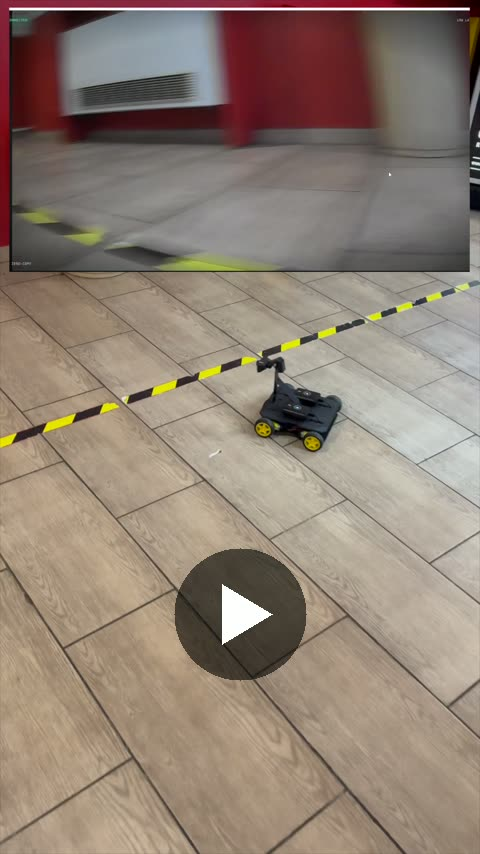
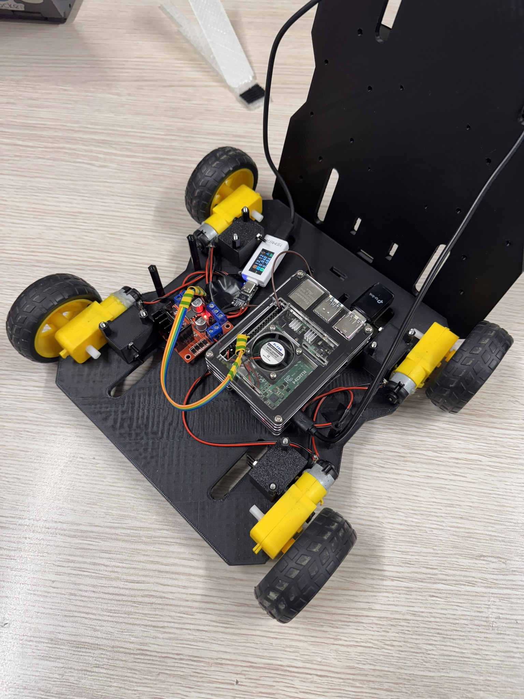
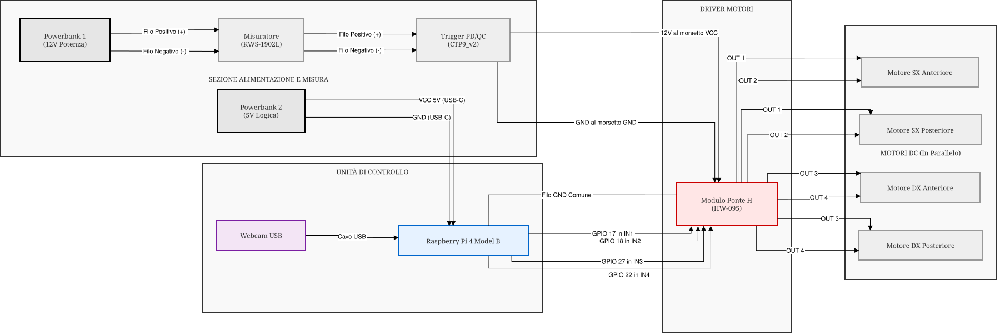
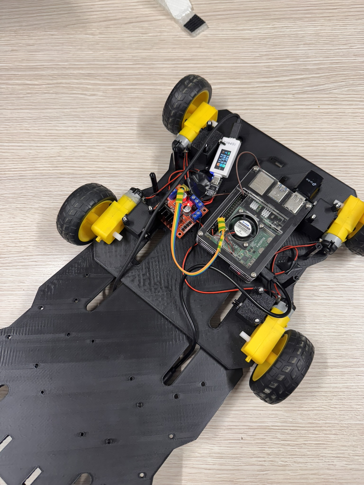
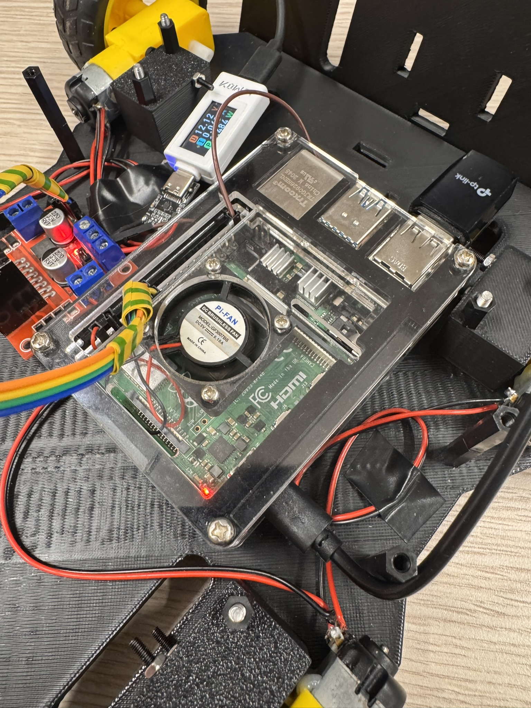
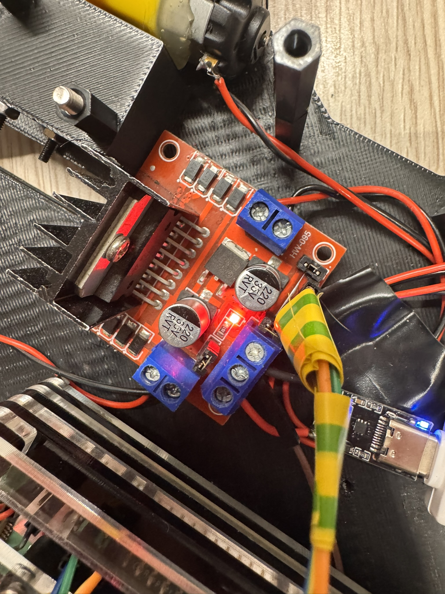
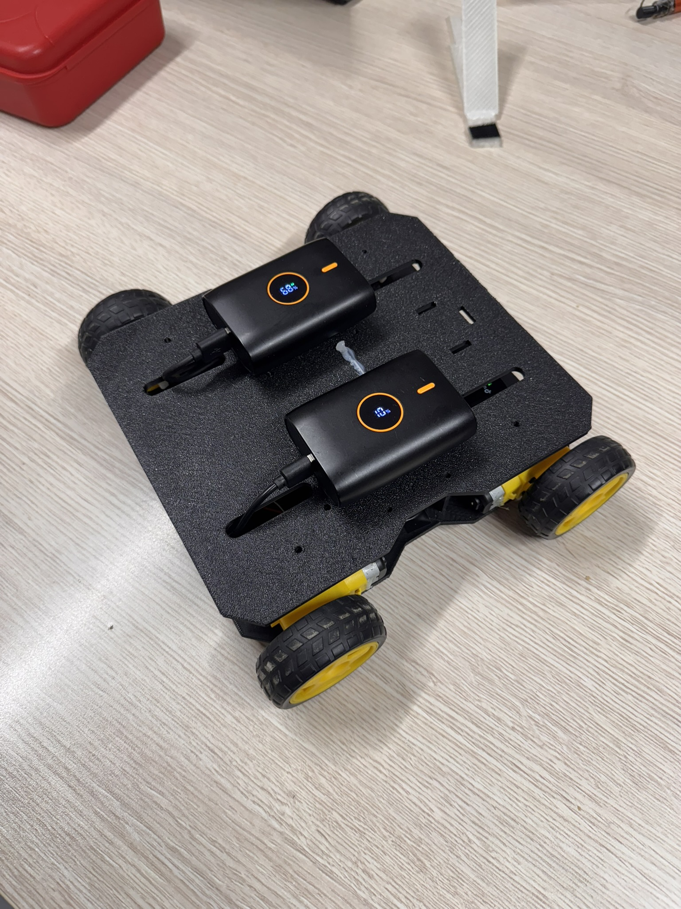
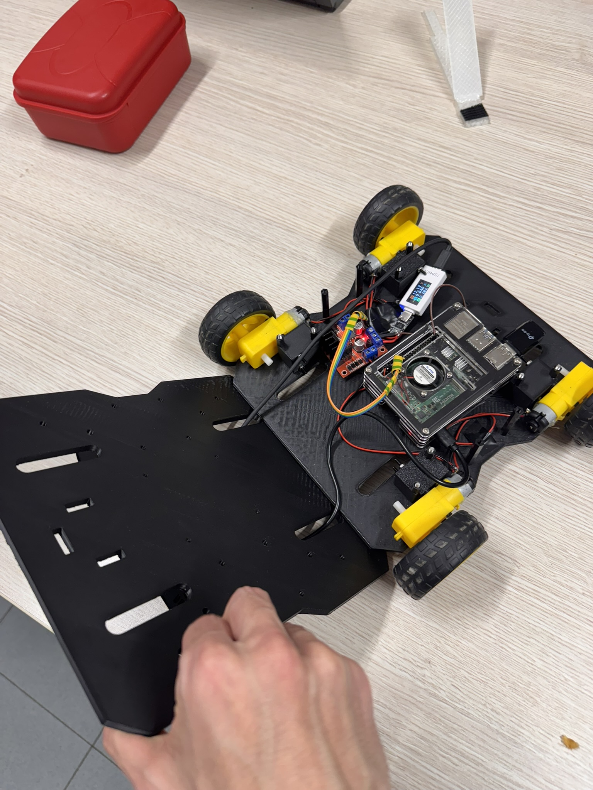
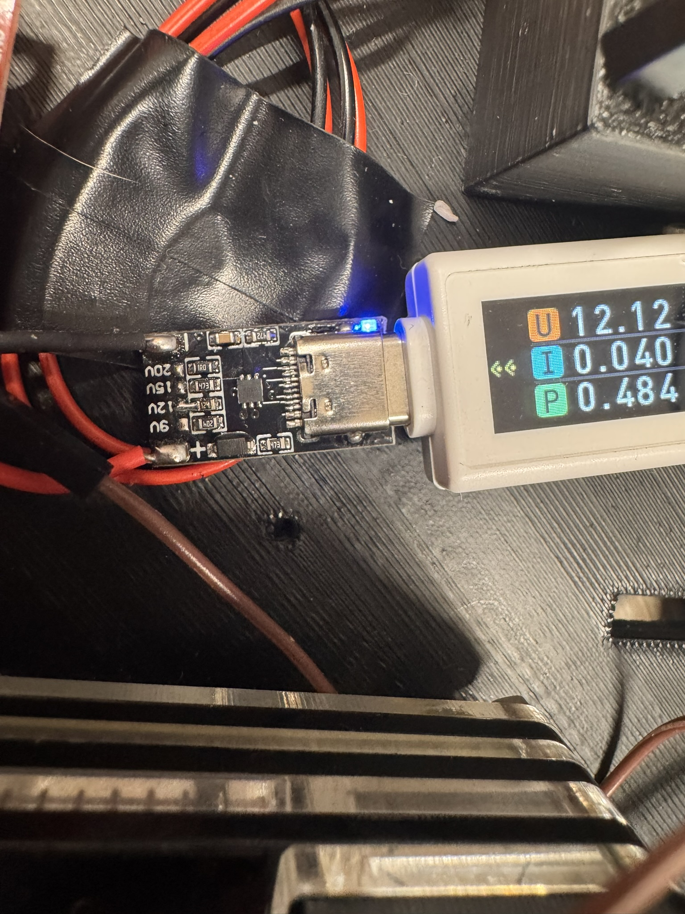

<h1 align="center">Wii Remote Controlled Vehicle · Live Video Stream</h1>

<p align="center">
  Macchinina in stampa 3D guidata con un Wii Remote,<br>
  con diretta video dalla webcam di bordo.
</p>

<p align="center">
  <a href="demo.mp4"></a>
  &nbsp;
  
</p>

<p align="center">
  <a href="presentazione.pdf">Presentazione</a> · <a href="relazione.pdf">Relazione</a>
</p>

---

## ✨ Cosa fa

| Funzione | Come funziona |
|---|---|
| 🎮 **Guida con il Wiimote** | Inclini il telecomando per sterzare, tasto **2** per accelerare, tasto **1** per la retromarcia |
| 📡 **Live in tempo reale** | La webcam di bordo trasmette in H.264 a 1280×720 / 30 fps: basta aprire `http://<IP_RASPBERRY>:5000` |
| ↔️ **Torque vectoring** | Niente sterzo meccanico: la macchina curva variando la potenza (PWM) tra le ruote di destra e di sinistra |
| 📳 **Feedback aptico** | Il Wiimote vibra mentre la macchina è in movimento |
| 🔋 **Doppia alimentazione** | Due power bank: 5 V per il Raspberry Pi, 12 V per i motori tramite PD trigger USB-C |

## 🔌 Schema del circuito

<p align="center">
  
</p>

## 📸 Galleria

<table>
  <tr>
    <td align="center" width="33%"><br><sub>Tutta l'elettronica sul telaio</sub></td>
    <td align="center" width="33%"><br><sub>Raspberry Pi 4 con ventola e tester USB-C</sub></td>
    <td align="center" width="33%"><br><sub>Ponte H L298N e PD trigger</sub></td>
  </tr>
  <tr>
    <td align="center"><br><sub>Macchina chiusa con i due power bank</sub></td>
    <td align="center"><br><sub>Montaggio del telaio in stampa 3D</sub></td>
    <td align="center"><br><sub>PD trigger: 12 V dal power bank</sub></td>
  </tr>
</table>

Altre foto nella cartella [`foto/`](foto).

## 🧰 Hardware

- Raspberry Pi 4 Model B
- Ponte H L298N ([datasheet](docs/datasheet/l298n-driver-motori.pdf))
- 4× motoriduttori DC TT 1:48 ([datasheet](docs/datasheet/motoriduttore-dc.pdf))
- USB-C PD trigger board (12 V)
- 2× power bank da 10.000 mAh
- Webcam USB + adattatore Ethernet TP-Link UE300
- Nintendo Wii Remote
- Telaio in stampa 3D, basato sul modello [DIPLO V1](https://www.thingiverse.com/thing:7036364) (vedi [Crediti](#-crediti))

## 📁 Struttura della repo

```
wii-remote-controlled-vehicle-live-video-stream/
├── demo.mp4              # video demo
├── schema-circuito.svg   # schema del circuito (si apre con draw.io)
├── presentazione.pdf
├── relazione.pdf
├── foto/                 # foto della macchina
├── src/                  # codice che gira sul Raspberry Pi
│   ├── start.sh          # avvia live webcam + controller Wiimote
│   ├── restart-camera.sh
│   ├── restart-wiiremote.sh
│   ├── webcam-stream/    # server Flask per lo streaming live
│   └── wiimote/          # submodule → FukkitWiiBall (controllo motori in C)
└── docs/
    ├── relazione.md      # sorgente della relazione
    ├── img/
    └── datasheet/
```

## 🚀 Avvio

### 1. Clonare la repo (con il submodule)

Il controller dei motori è la repo [FukkitWiiBall](https://github.com/lellopastellone/FukkitWiiBall), inclusa come submodule:

```bash
git clone --recurse-submodules <url-della-repo>
```

Se hai già clonato senza `--recurse-submodules`:

```bash
git submodule update --init --recursive
```

Per aggiornare il controller all'ultima versione:

```bash
git submodule update --remote src/wiimote
```

### 2. Avviare sul Raspberry Pi

```bash
cd src
./start.sh
```

Poi premi **1 + 2** sul Wiimote per accoppiarlo e apri `http://<IP_RASPBERRY>:5000` per vedere la diretta.

Per riavviare un solo processo:

```bash
./restart-camera.sh
./restart-wiiremote.sh
```

### 3. Avvio automatico all'accensione (`cron @reboot`)

I percorsi assumono che la repo sia clonata in `/home/raspberrypi/Desktop/wii-remote-controlled-vehicle-live-video-stream`.

```bash
# vedi la regola attiva
sudo crontab -l

# disabilita auto-start
sudo crontab -l | grep -v "start.sh" | sudo crontab -

# riabilita auto-start
(sudo crontab -l 2>/dev/null; echo "@reboot /bin/bash /home/raspberrypi/Desktop/wii-remote-controlled-vehicle-live-video-stream/src/start.sh >> /home/raspberrypi/Desktop/wii-remote-controlled-vehicle-live-video-stream/src/boot.log 2>&1") | sudo crontab -

# vedi log dell'ultimo avvio
cat ~/Desktop/wii-remote-controlled-vehicle-live-video-stream/src/boot.log
```

## 🙏 Crediti

- **Telaio**: [DIPLO V1 - Vision Artificial Car for Raspberry Pi](https://www.thingiverse.com/thing:7036364) di **Nightmare_Sena04** su Thingiverse, rilasciato con licenza [CC0 1.0 (Public Domain)](https://creativecommons.org/publicdomain/zero/1.0/).
## 👥 Autori

**Alessio Langellotti** · **Leonardo Sigalini** · **Luca Miglioli**

Progetto di Elettronica Generale, A.A. 2025/2026
