

# RELAZIONE DI ELETTRONICA GENERALE

## Progettazione di un Veicolo a Guida Remota con Interfaccia Wii Remote, Struttura in Stampa 3D e Trasmissione Video Live via HTTP

 

### Componenti del gruppo

**Leonardo Sigalini**  
**Alessio Langellotti**  
**Luca Miglioli**

 

Anno Accademico 2025/2026

---

## Indice

1. [Introduzione](#1-introduzione)
2. [Architettura del Sistema](#2-architettura-del-sistema)
3. [Componenti Hardware](#3-componenti-hardware)
   - 3.1 Motoriduttori DC
   - 3.2 Ponte H – L298N
   - 3.3 Raspberry Pi 4
   - 3.4 USB-C PD Trigger Board
   - 3.5 Power Bank
   - 3.6 Adattatore Ethernet USB
   - 3.7 Tester USB-C
4. [Funzionamento del Software](#4-funzionamento-del-software)
   - 4.1 Librerie utilizzate
   - 4.2 Procedura di connessione
5. [Accelerometro](#5-accelerometro)
6. [PWM e Gestione dello Sterzo](#6-pwm-e-gestione-dello-sterzo)
7. [Comunicazione Bluetooth: HID over L2CAP](#7-comunicazione-bluetooth-hid-over-l2cap)
   - 7.1 Struttura del protocollo
   - 7.2 Rumble (feedback aptico)
   - 7.3 Player LED
   - 7.4 Data Report
   - 7.5 Approfondimento: HID over L2CAP

---

## 1. Introduzione

Il progetto prevede la realizzazione di un veicolo telecomandato controllato tramite un **Nintendo Wii Remote** (*Wiimote*), collegato via Bluetooth a un **Raspberry Pi 4**. Il Raspberry Pi gestisce i motori DC attraverso un ponte a H e trasmette in tempo reale il flusso video di una webcam tramite rete locale.

Lo sterzo del veicolo viene controllato sfruttando l'**accelerometro** integrato nel Wiimote (Wii MotionPlus): l'inclinazione laterale del telecomando si traduce direttamente in un comando direzionale al veicolo.

Il progetto costituisce un caso di studio per la comprensione approfondita di:

- Funzionamento dei **motori in corrente continua**
- Pilotaggio tramite **ponte a H**
- Modulazione **PWM** (Pulse Width Modulation)
- Principi di funzionamento degli **accelerometri MEMS**
- Protocollo di comunicazione **HID over L2CAP** (Bluetooth Classic)

---

## 2. Architettura del Sistema

Lo schema seguente illustra l'architettura complessiva del sistema, mostrando le connessioni tra i vari componenti hardware.

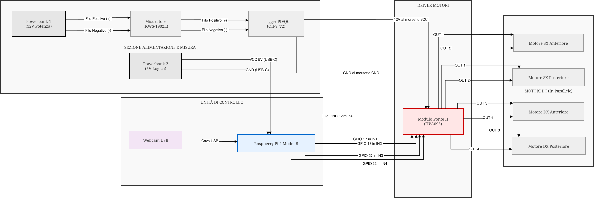

<em>Figura 2.1 – Schema a blocchi dell'architettura del sistema</em>

Il sistema è composto da:

- **Wiimote** → invia comandi via Bluetooth al Raspberry Pi
- **Raspberry Pi 4** → unità di elaborazione centrale; riceve i comandi, pilota i motori, gestisce lo streaming video
- **Ponte H (L298N)** → pilota i 4 motori DC in base ai segnali PWM ricevuti dal Raspberry Pi
- **4× Motoriduttori DC** → collegati in parallelo (2 per lato), forniscono la trazione
- **USB-C PD Trigger Board** → negozia 12V dal power bank per alimentare i motori
- **2× Power Bank** → alimentano separatamente il Raspberry Pi (5V) e i motori (12V via PD trigger)
- **Webcam + Adattatore Ethernet** → streaming video in tempo reale tramite hotspot

---

## 3. Componenti Hardware

### 3.1 Motoriduttore DC – TT Motor a Doppio Albero

<table><tr><td width="65%">

Il veicolo utilizza **4 motoriduttori** DC con rapporto di riduzione 1:48, collegati in parallelo (2 per ciascun lato). La configurazione a doppio albero consente il montaggio diretto delle ruote.

| Parametro | 3V | 6V | 12V |
|---|---|---|---|
| Corrente di stallo | ~150 mA | ~200 mA | ~350 mA |
| Velocità a vuoto | ~90 RPM | ~200 RPM | ~350 RPM |
| Coppia di stallo | ~0.3 kg·cm | ~0.8 kg·cm | ~1.5 kg·cm |
| Rapporto di riduzione | 1:48 | 1:48 | 1:48 |

</td><td width="35%" align="center">
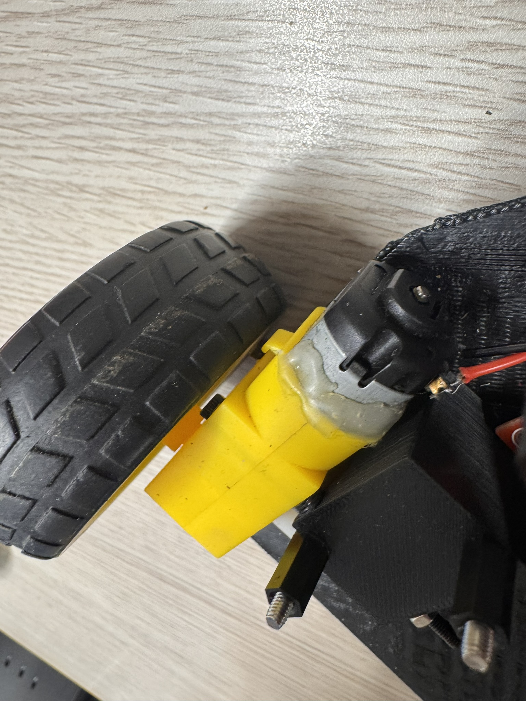
 <em>Figura 3.1 – Motoriduttore TT DC</em>
</td></tr></table>

### 3.2 Ponte H – L298N Dual H-Bridge

<table><tr><td width="60%">

Il modulo **L298N** è un driver a doppio ponte H che consente il controllo bidirezionale di due motori DC. Viene alimentato a 12V e riceve segnali PWM dal Raspberry Pi per la regolazione della velocità e della direzione di rotazione.

| Parametro | Valore |
|---|---|
| Driver IC | L298N (dual H-bridge) |
| Tensione di alimentazione | 5V – 35V DC |
| Corrente per canale | 2A (picco) |
| Logica input LOW | −0.3V → 1.5V |
| Logica input HIGH | 2.3V → Vss |
| Potenza massima | ~20W @ 75°C |
| Regolatore onboard | 5V integrato |
| Direzione motori | Bidirezionale (2 canali) |
| Dimensioni | 34 × 43 × 27 mm |

</td><td width="40%" align="center">
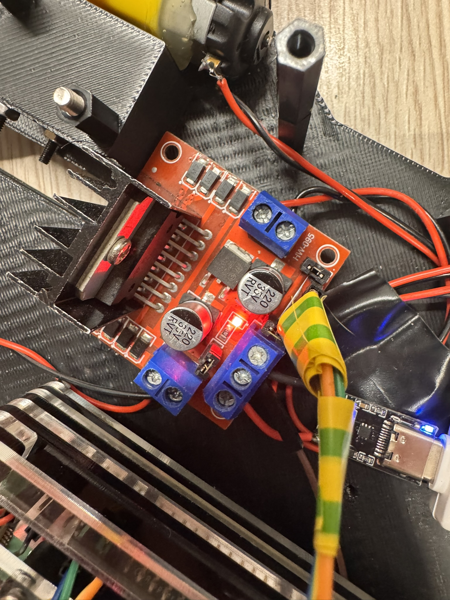
 <em>Figura 3.2 – Modulo driver L298N</em>
</td></tr></table>

### 3.3 Raspberry Pi 4 Model B

<table><tr><td width="60%">

Il Raspberry Pi 4 è il cuore computazionale del sistema. Gestisce:

- La connessione Bluetooth con il Wiimote
- L'elaborazione dei dati dell'accelerometro
- La generazione dei segnali PWM per il ponte H
- Lo streaming video tramite web server integrato

| Componente | Specifica |
|---|---|
| SoC | Broadcom BCM2711, Quad-core Cortex-A72 @ 1.5 GHz |
| RAM | 1 / 2 / 4 / 8 GB LPDDR4-3200 |
| GPU | VideoCore VI (OpenGL ES 3.1, Vulkan 1.0) |
| Alimentazione | USB-C, 5V ⎓ 3A |
| USB | 2× USB 3.0 + 2× USB 2.0 |
| Connettività | Gigabit Ethernet, Wi-Fi 802.11ac, Bluetooth 5.0 |
| Display | 2× micro-HDMI (fino a 4K) |
| Storage | Slot MicroSD |

</td><td width="40%" align="center">
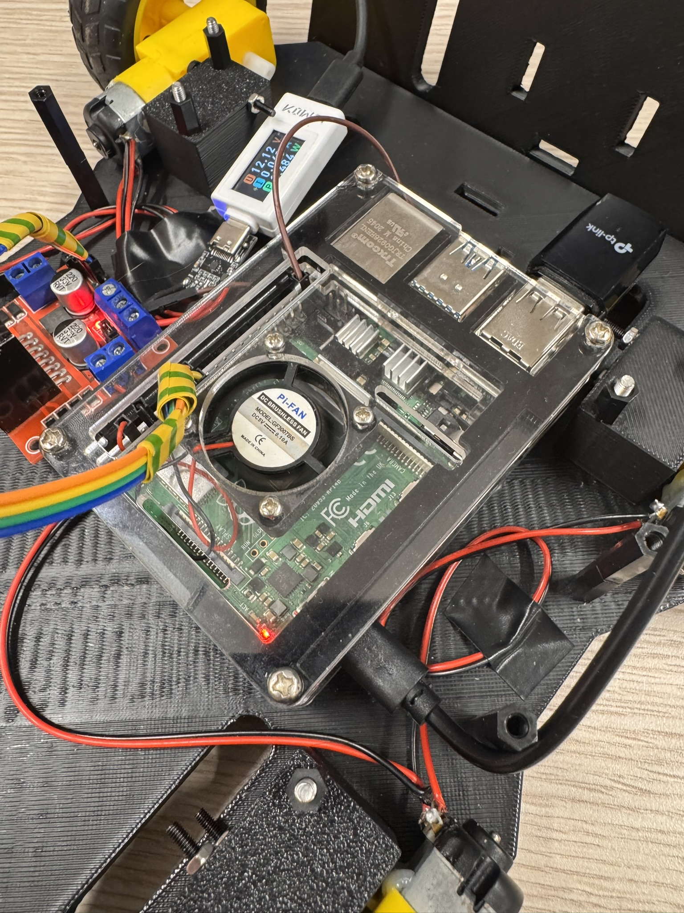
 <em>Figura 3.3 – Raspberry Pi 4 Model B</em>
</td></tr></table>

### 3.4 USB-C PD Trigger Board

<table><tr><td width="60%">

Questo modulo consente di **forzare la negoziazione di una tensione fissa** (nel nostro caso 12V) da un alimentatore USB-C compatibile con Power Delivery. È necessario perché il power bank, di default, eroga 5V sulla porta USB-C.

| Parametro | Valore |
|---|---|
| Protocolli supportati | USB PD 2.0/3.0, PPS, QC 2.0/3.0/4+ |
| Tensioni selezionabili | 9V / 12V / 15V / 20V |
| Corrente massima | Fino a 5A |
| Potenza massima | Fino a 100W |
| Metodo selezione | Ponticelli / pad saldabili |
| Negoziazione | Automatica con alimentatore PD/QC |
| Dimensioni | PCB compatto (~20–30 mm) |

</td><td width="40%" align="center">
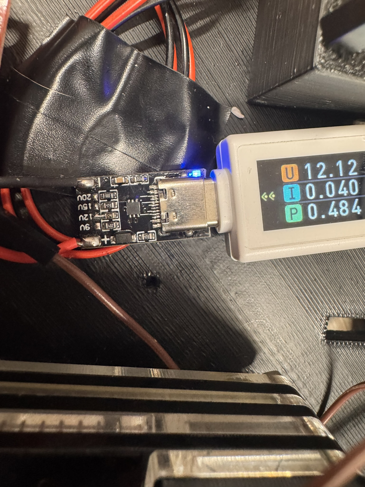
 <em>Figura 3.4 – PD Trigger Board</em>
</td></tr></table>

### 3.5 Power Bank (×2)

<table><tr><td width="65%">

Il sistema utilizza **due power bank identici**, poiché non è possibile utilizzare contemporaneamente la porta USB Power Delivery e le porte standard sullo stesso dispositivo:

- **Power bank 1** → alimenta il Raspberry Pi a 5V (porta USB-A)
- **Power bank 2** → alimenta i motori a 12V (tramite PD Trigger sulla porta USB-C)

| Parametro | Valore |
|---|---|
| Chimica | Litio-polimero (Li-Po) |
| Capacità | 10.000 mAh (~37 Wh) |
| Potenza in uscita | Fino a 22.5W |
| Profili tensione | 5V / 9V / 12V (negoziazione PD) |
| Porte di uscita | USB-A (QC 3.0) + USB-C (PD) |
| Protezioni | Sovracorrente, sovratensione, cortocircuito, temperatura |

</td><td width="35%" align="center">
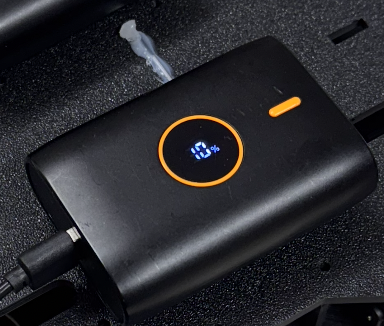
 <em>Figura 3.5 – Power bank 10.000 mAh</em>
</td></tr></table>

### 3.6 Adattatore Ethernet USB – TP-Link UE300

<table><tr><td width="60%">

L'adattatore viene utilizzato per creare un **hotspot ethernet** dedicato, sul quale viene trasmesso il flusso video della webcam. Questo permette una connessione stabile e a bassa latenza per lo streaming.

| Parametro | Valore |
|---|---|
| Alimentazione | Bus-powered (5V da porta USB) |
| Consumo tipico | ~0.5W – 1W |
| Consumo di picco | ~1–2W (trasferimento Gigabit) |

</td><td width="40%" align="center">
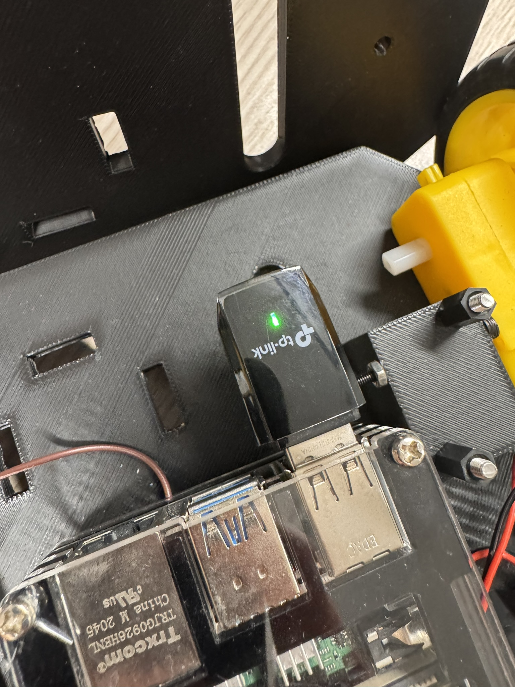
 <em>Figura 3.6 – Adattatore TP-Link UE300</em>
</td></tr></table>

### 3.7 Tester USB-C

<table><tr><td width="60%">

Strumento utilizzato in fase di sviluppo per monitorare tensione, corrente e potenza assorbita dai vari componenti del sistema.

| Parametro | Valore |
|---|---|
| Tensione di ingresso | 4V – 30V DC |
| Range corrente | 0 – 8A (picco ~12A) |
| Potenza misurabile | Fino a ~240W |
| Display | 0.96" TFT |
| Misure | Tensione, corrente, potenza, energia (Wh), capacità (mAh) |
| Dimensioni | ~40 × 20 × 10 mm |

</td><td width="40%" align="center">
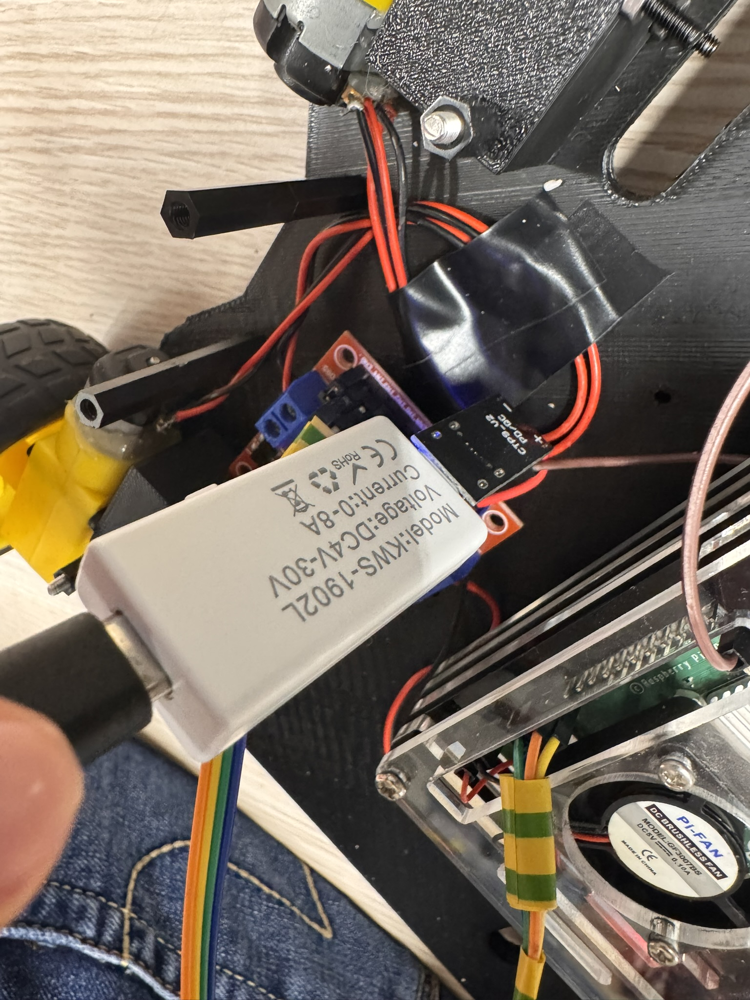
 <em>Figura 3.7 – Tester USB-C</em>
</td></tr></table>

---

## 4. Funzionamento del Software

### 4.1 Librerie utilizzate

Il software di controllo è stato sviluppato in **linguaggio C** e implementato nel file **CarControl.c**. Le librerie impiegate sono:

| Libreria | Funzione |
|---|---|
| **wiiuse** | Elaborazione dei dati comunicati dal Wiimote (accelerometro, pulsanti) |
| **pigpio** | Controllo dei pin GPIO del Raspberry Pi (generazione PWM) |
| **bluetooth** | Gestione del pairing Bluetooth con il telecomando |
| **math** | Funzioni matematiche per il calcolo dei valori dell'accelerometro |
| **pthread** | Gestione della concorrenza per operazioni GPIO simultanee |

### 4.2 Procedura di connessione

La procedura di accoppiamento (*pairing*) prevede:

1. Esecuzione del binario compilato sul Raspberry Pi
2. Attivazione della **modalità discovery** sul Wiimote (pressione simultanea dei tasti "1" + "2")
3. Stabilimento della connessione Bluetooth
4. Inizializzazione del dispositivo e ingresso in stato operativo

<table><tr>
<td align="center" width="50%">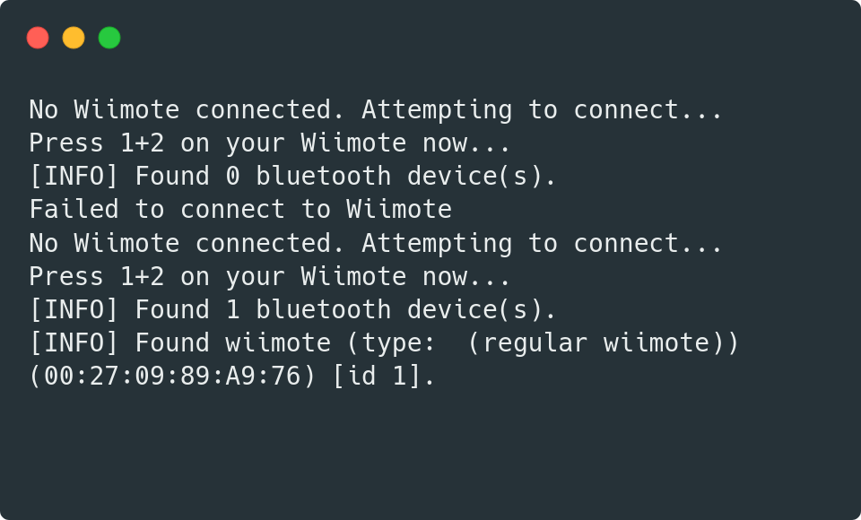</td>
<td align="center" width="50%">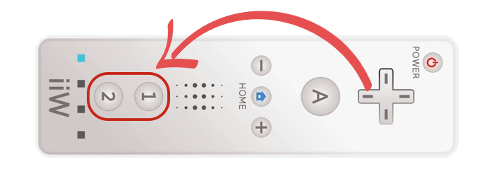</td>
</tr></table>

<em>Figura 4.1 – Processo di pairing tra il veicolo e il Wiimote</em>

Una volta connesso:
- **Tasto "2"** → propulsione in avanti
- **Tasto "1"** → retromarcia
- **Inclinazione laterale** → controllo direzionale (sterzo)

---

## 5. Accelerometro

### Principio di funzionamento

<table><tr><td width="70%">

All'interno del Wiimote è integrato un accelerometro **ADXL330**, prodotto da *Analog Devices*, un sensore a tre assi di tipo **MEMS** (Micro-Electro-Mechanical System).

L'accelerometro misura l'accelerazione specifica lungo tre assi (X, Y, Z). Rileva sia le variazioni di accelerazione dovute al movimento, sia la componente statica associata all'accelerazione di gravità. Per questo motivo può essere utilizzato sia per l'analisi del moto dinamico sia per la determinazione dell'orientamento nello spazio.

</td><td width="30%" align="center">
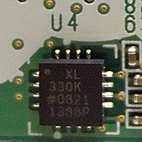
 <em>Figura 5.1 – ADXL330</em>
</td></tr></table>

### Funzionamento del sensore MEMS

<table><tr><td width="65%">

All'interno dell'ADXL330 è presente una **massa sospesa** tramite strutture elastiche microscopiche. Quando il dispositivo viene accelerato, la massa tende a rimanere indietro per effetto dell'inerzia, causando uno spostamento rispetto alla struttura fissa del sensore.

Questo spostamento viene rilevato tramite un **sistema capacitivo**: le variazioni nella posizione della massa provocano variazioni della capacità elettrica tra microelettrodi, convertite poi in segnali elettrici proporzionali all'accelerazione lungo ciascun asse.

</td><td width="35%" align="center">
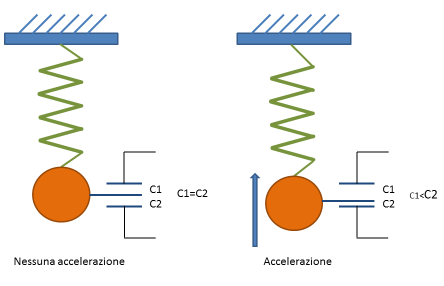
 <em>Figura 5.2 – Sensore MEMS capacitivo</em>
</td></tr></table>

---

## 6. PWM e Gestione dello Sterzo

### Acquisizione dei dati

<table><tr><td width="65%">

Il Wiimote invia via Bluetooth i dati dell'accelerometro al Raspberry Pi. I dati grezzi vengono elaborati dalla libreria **wiiuse** (conversione in valori float) e successivamente dal codice di controllo, che proporziona l'inclinazione del telecomando alla potenza da fornire ai motori.

Il valore principale utilizzato è il **pitch** (beccheggio): la rotazione attorno all'asse X (asse trasversale) del Wiimote.

</td><td width="35%" align="center">
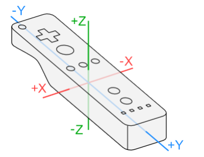
 <em>Figura 6.1 – Coordinate del Wiimote</em>
</td></tr></table>

### Strategia di sterzo: Torque Vectoring

Lo sterzo è implementato mediante una strategia di **torque vectoring**: la modulazione differenziale della coppia motrice tra il lato destro e il lato sinistro del veicolo consente di variarne la traiettoria senza un meccanismo di sterzata meccanico.

### Modulazione PWM

<table><tr><td width="60%">

La regolazione della potenza erogata ai motori avviene tramite **Pulse Width Modulation** (PWM). Anziché un segnale analogico continuo, viene generato un segnale digitale periodico che commuta rapidamente tra stato alto e basso.

Il parametro fondamentale è il **duty cycle**: la percentuale di tempo in cui il segnale rimane nello stato alto all'interno di un periodo. Variando il duty cycle si modula il valore medio di tensione applicato ai motori:

- **Duty cycle 100%** → massima velocità
- **Duty cycle 50%** → metà velocità
- **Duty cycle 0%** → motore fermo

Nel sistema di sterzo, il duty cycle dei segnali PWM viene variato in funzione dell'inclinazione del telecomando, creando una differenza di velocità tra le ruote dei due lati.

</td><td width="40%" align="center">
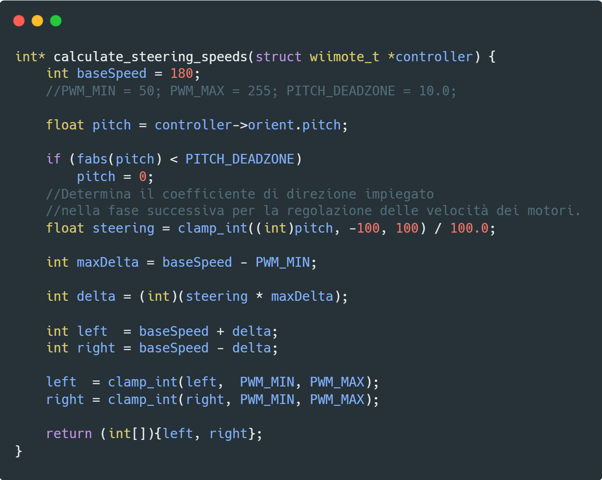
 <em>Figura 6.2 – Codice calcolo PWM</em>
</td></tr></table>

---

## 7. Comunicazione Bluetooth: HID over L2CAP

### 7.1 Struttura del protocollo

<table><tr><td width="60%">

Una volta completato il pairing, il Raspberry Pi instaura un canale **L2CAP** (Logical Link Control and Adaptation Protocol) sul profilo **HID** (Human Interface Device) del Wiimote. Questo consente lo scambio di **report strutturati** tra host e dispositivo.

Ogni report è una sequenza di byte che rappresenta lo stato del dispositivo in un dato istante. La comunicazione distingue tra:

- **Input report** (Wiimote → Raspberry Pi) – header **0xA1**
- **Output report** (Raspberry Pi → Wiimote) – header **0xA2**

</td><td width="40%" align="center">
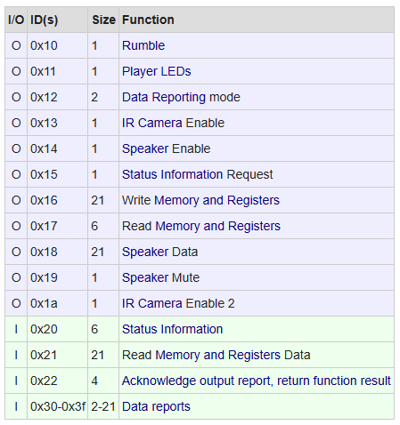
 <em>Figura 7.1 – Stack protocollare Bluetooth</em>
</td></tr></table>

### 7.2 Rumble (Feedback Aptico)

<table><tr><td width="70%">

La vibrazione del Wiimote è stata implementata come **feedback aptico**: si attiva durante le fasi di movimento del veicolo, aumentando l'immersività del controllo.

Il pacchetto di controllo segue la struttura di un Output report HID:

</td><td width="30%" align="center">
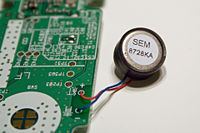
 <em>Figura 7.2 – Motore di vibrazione</em>
</td></tr></table>

> **0xA2  0x10  [RR]**

Il campo **[RR]** rappresenta il byte di controllo della vibrazione:

| Valore | Stato |
|---|---|
| **0x00** | Rumble disattivato |
| **0x01** | Rumble attivo |

### 7.3 Player LED

<table><tr><td width="70%">

I quattro LED blu sulla parte frontale del Wiimote vengono utilizzati per fornire feedback visivo sull'esito della procedura di accoppiamento:

- **Pairing corretto** → attivazione del **LED 1**
- **Errore di connessione** → attivazione del **LED 2** (segnalazione di fault)

</td><td width="30%" align="center">
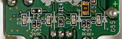
 <em>Figura 7.4 – LED del Wiimote</em>
</td></tr></table>

Il nibble più significativo del byte **[LL]** controlla lo stato dei quattro LED:

> **0xA2  0x11  [LL]**

| Bit | Mask | LED |
|---|---|---|
| 4 | 0x10 | LED 1 |
| 5 | 0x20 | LED 2 |
| 6 | 0x40 | LED 3 |
| 7 | 0x80 | LED 4 |

### 7.4 Data Report

Il Wiimote comunica con l'host tramite l'invio periodico di **data report**, contenenti informazioni sullo stato dei sensori e degli input utente. Il protocollo HID implementato offre diversi formati di report selezionabili dinamicamente dall'host in base alle funzionalità abilitate.

Formato base (Report 0x30):

> **0xA1  0x30  [Byte_1]  [Byte_2]**

#### Report 0x31: Pulsanti + Accelerometro

Il data report con ID **0x31** è il formato utilizzato nel progetto, in quanto include simultaneamente lo stato dei pulsanti e i dati dell'accelerometro.

> **0xA1  0x31  [BB_1]  [BB_2]  [X_axis]  [Y_axis]  [Z_axis]**

#### Codifica dei pulsanti

<table><tr><td width="55%">

I pulsanti sono codificati mediante **rappresentazione bitwise** nei byte [BB_1] e [BB_2]:

- Valore **1** → pulsante premuto
- Valore **0** → pulsante non premuto

Questa codifica consente di rappresentare l'intero set di pulsanti in soli 2 byte tramite una **bitmask**.

</td><td width="45%" align="center">
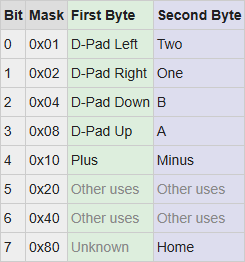
 <em>Figura 7.9 – Mappatura bitwise dei pulsanti</em>
</td></tr></table>

#### Codifica dell'accelerometro

I campi [X_axis], [Y_axis] e [Z_axis] sono **byte unsigned** che descrivono l'accelerazione lungo ciascun asse. Il valore di riferimento (zero-g) è codificato come **0x80**, introducendo un offset che permette di rappresentare accelerazioni sia positive sia negative.

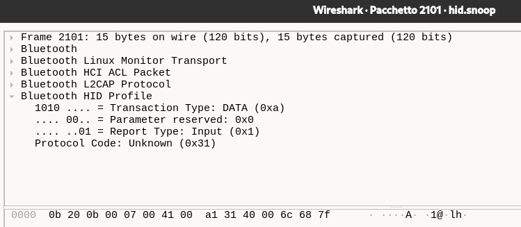

<em>Figura 7.10 – Esempio di data report analizzato con Wireshark</em>

### 7.5 Approfondimento: HID over L2CAP

Quando si parla di **HID over L2CAP**, si descrive il meccanismo con cui dispositivi di input (come il Wiimote) comunicano su **Bluetooth Classic** utilizzando il livello L2CAP come trasporto.

I due concetti fondamentali sono:

| Livello | Ruolo |
|---|---|
| **HID** (Human Interface Device) | Definisce *cosa* viene trasmesso (es. "è stato premuto il tasto A") |
| **L2CAP** (Logical Link Control and Adaptation Protocol) | Definisce *come* i dati vengono trasportati sopra Bluetooth |

L2CAP è un livello intermedio nello stack Bluetooth: incapsula i dati in pacchetti, li frammenta se necessario e permette di mantenere più **canali logici** sulla stessa connessione fisica.

#### Canali di comunicazione

HID over L2CAP utilizza **due canali distinti**, ciascuno con un ruolo specifico:

| Canale | PSM | Funzione |
|---|---|---|
| **Control Channel** | 0x11 | Gestione della sessione (setup, configurazione) |
| **Interrupt Channel** | 0x13 | Trasporto dei report HID (dati operativi) |

Il **Control Channel** è utilizzato per la gestione della sessione e la configurazione del dispositivo. L'**Interrupt Channel** è il canale operativo su cui transitano i report HID contenenti i dati di input e output.
